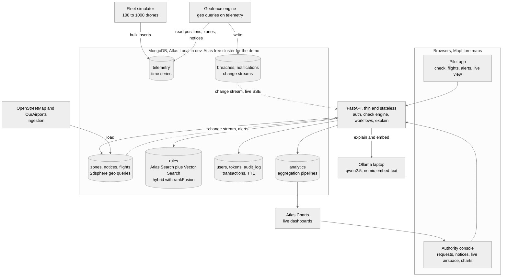
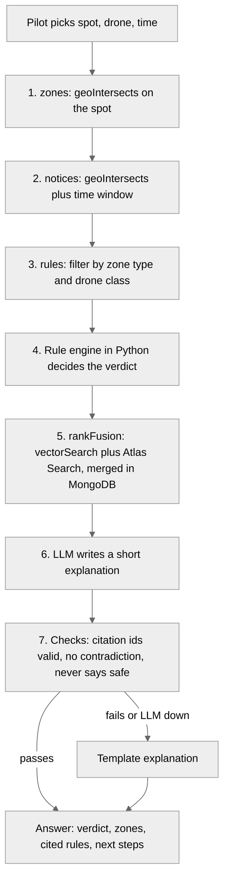
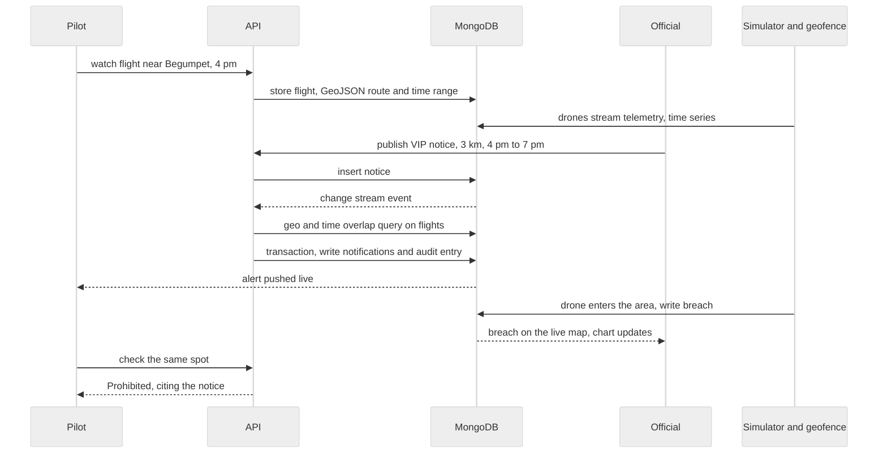

# SkyClear architecture

SkyClear is a MongoDB-first airspace platform. The API is thin on purpose: geo search, text and vector search, hybrid ranking, time series, live updates, transactions and analytics all run inside MongoDB. Everything else in the stack is open source. This is a MongoDB hackathon, so every design choice below prefers a MongoDB feature over an extra service.

## What we are building

- Pilot side: check a spot, route or drone before flying, see the exact rules behind the answer, register drones, watch a flight, request permission, get alerted when a restriction appears.
- Authority side: review and decide permission requests, publish restrictions such as VIP movements, see live airspace and analytics.
- Simulation: a fleet of simulated drones flies over Hyderabad, is checked live against zones and notices, and breaches appear on both sides in seconds.

## MongoDB feature map (the judging story)

| # | MongoDB feature | Where we use it | Owner | Status |
|---|---|---|---|---|
| 1 | Geospatial: 2dsphere, `$geoIntersects`, `$geoNear`, `$geoWithin`, GeoJSON polygons and LineStrings | Which zone a spot is in, zones in the map viewport, nearest zones, flight routes, matching flights to notices | Manohari | zones and checks done, viewport done, rest to build |
| 2 | Atlas Vector Search (`$vectorSearch` with pre-filter) | Rule passages for the explanation | Manohari | built, needs the Ollama laptop |
| 3 | Atlas Search (Lucene `$search`) | Keyword rule search, autocomplete on zone names for the search box, fuzzy matching | Manohari | verified working locally, to wire in |
| 4 | Hybrid search with `$rankFusion` (vector plus `$search`, merged inside the database) | Best rule passages for each answer, and the Ask SkyClear question box (`POST /ask`), cited and grounded | Manohari | verified working locally, replaces our hand-written merge |
| 5 | Change streams | Alerts when a notice is published, the live feed of positions and breaches | Nikhil, Thanvi | to build |
| 6 | Time series collections, `$setWindowFields` | Drone telemetry, speed and track smoothing | Thanvi | to build |
| 7 | Multi-document transactions | Permission decision, audit entry and notification written together | Nikhil | to build |
| 8 | Aggregation framework (`$facet`, `$bucket`, `$group`, `$merge` into summary collections) | Authority analytics, heatmap, breaches per zone | Manohari | to build |
| 9 | Schema validation, compound and partial indexes, TTL indexes, `explain()` | Data quality, speed proof, expiring tokens and telemetry | Manohari, Nikhil | partly built |
| 10 | MongoDB Atlas (free cluster) and Atlas Charts on live data | Demo database and the authority charts | Suhas | to build, limits to verify |
| 11 | MongoDB MCP server (open source) | Stretch: ask the airspace questions in plain language | Manohari | idea |

Deliberately not used: Redis, Kafka, Elasticsearch, a separate vector database. MongoDB replaces all of them here, and that is part of the pitch.

## System diagram

## One check, step by step

## The demo story: a VIP movement

## Data model

| Collection | Key fields | Indexes and features |
|---|---|---|
| zones | zone_id, name, zone_type, geometry, rule_ids, source | 2dsphere on geometry, unique zone_id, Atlas Search autocomplete on name, schema validation |
| notices | notice_id, title, area, starts_at, ends_at, status, origin | 2dsphere on area, compound status and ends_at, change stream |
| flights | flight_id, pilot_id, drone_id, route or area, start, end, status, verdict | 2dsphere plus time range, compound pilot_id and status |
| telemetry | ts, drone_id, flight_id, position, alt_m, speed_mps, heading_deg, battery_pct, source | Time series (timeField ts, metaField drone_id), 2dsphere on position, TTL |
| breaches | event_id, drone_id, kind, name, position, severity, ts | Change stream feeds the live view |
| rules | rule_id, text, embedding, zone_type, drone_classes, effective_from, source | Vector index, Atlas Search index, filters on zone_type and drone_classes |
| users, refresh_tokens | email, role, password hash, token family | Unique email, TTL on refresh tokens |
| notifications | user_id, kind, title, body, severity, read | Index on user_id and created_at, TTL 30 days, change stream |
| audit_log | actor, action, target, ts | Append-only |
| analytics_* | pre-aggregated heatmap and breach counts | Built with `$merge`, read by the dashboard and Atlas Charts |

## Components and open source

| Layer | Choice | License |
|---|---|---|
| Database | MongoDB 8 with Atlas Search and Vector Search (Atlas Local in Docker for dev, Atlas free cluster for the demo) | Server is SSPL (source available, not OSI open source). Honest note for the pitch |
| API | FastAPI, uvicorn | MIT, BSD |
| Auth | PyJWT, argon2-cffi, pyotp, slowapi | MIT, BSD |
| Simulation | Python asyncio fleet simulator, optional ArduPilot SITL with pymavlink | GPL for ArduPilot, run as a separate process |
| LLM and embeddings | Ollama with qwen2.5 and nomic-embed-text, on a separate laptop | MIT, Apache 2.0 |
| Map | MapLibre GL JS with OpenFreeMap vector tiles | BSD, free tiles |
| Frontend | Plain HTML and JS modules, no build step | |
| Geodata | OurAirports (public domain), OpenStreetMap through Geofabrik extracts | ODbL, attribution required |
| Optional ops | Nginx, Prometheus, Grafana, Locust | BSD, Apache, AGPL, MIT |

## Scale plan

| Concern | Approach |
|---|---|
| Map load | Browser asks for zones in the current viewport only (`/zones?bbox=`) |
| Telemetry volume | Time series collection, batched inserts, TTL, the live view reads only the latest position per drone |
| Alert fan-out | One geo and time query per new notice, using the flights index |
| Query speed | Compound and geo indexes, `explain()` checked, summary collections built with `$merge` |
| API throughput | Stateless replicas, connection pooling |
| Beyond one server | Shard telemetry by drone_id and time, zones by geohash prefix, written in docs/SCALING.md |
| Proof | Locust test, target 1000 simulated drones at 1 update per second, p95 of `/check` under 150 ms, numbers in docs/RESULTS.md |

## Security model

- Roles: pilot, official, admin. Officials are invited by an admin, never self-registered. Officials need TOTP.
- Access token 15 minutes, refresh token 7 days with rotation and reuse detection.
- argon2id password hashes, account lockout after repeated failures, rate limits.
- Every official action goes to audit_log.
- Notice text is data, never instructions (prompt injection guard exists in explain.py).
- Pilots see only their own flights, alerts and live drones. Officials see all.

## Not in scope

Real drone control, real regulator registry integration, payments. See PRODUCT.md for the honest limits.
