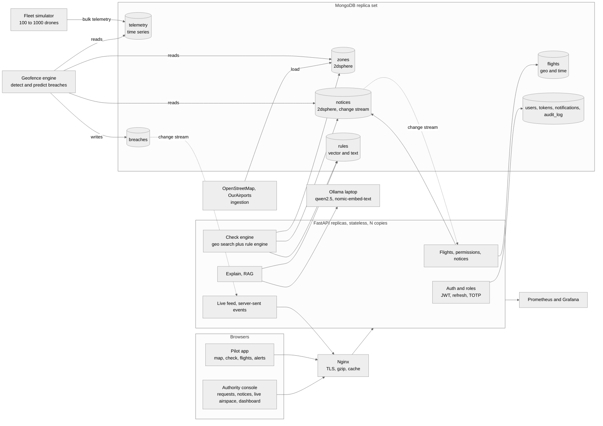
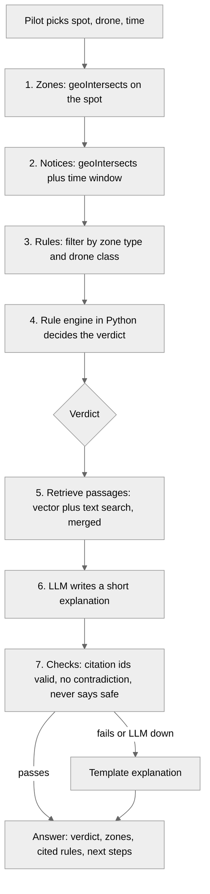
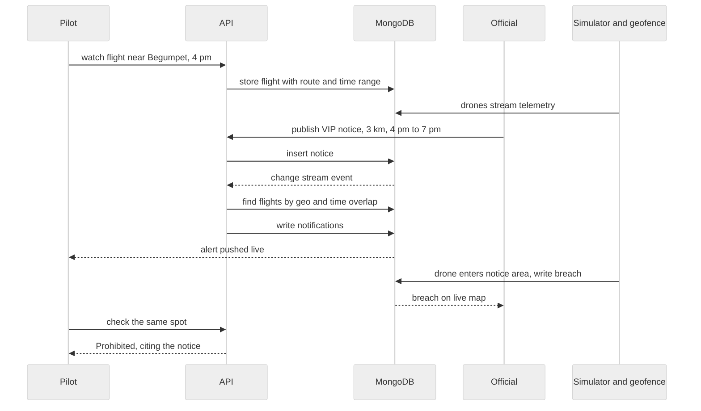

# SkyClear architecture

Target design for a high-scale platform. Everything is open source, and MongoDB does as much of the work as it can. The prototype already runs the core (checks, zones, accounts, flights, notices, alerts). This file says what the team builds on top of it.

## Principles

1. MongoDB first. Geo, time, vector, text, change streams, transactions and analytics all use MongoDB features, not extra services.
2. Stateless API. Any number of identical FastAPI replicas behind a load balancer. All state is in MongoDB.
3. Code decides, the LLM explains (unchanged). Every answer cites rules.
4. One data contract per boundary. See [docs/CONTRACTS.md](docs/CONTRACTS.md).
5. Open source only, with licenses and data attribution respected (OpenStreetMap data is ODbL).

## Components

| Layer | Choice | Why |
|---|---|---|
| Database | MongoDB 8 (replica set, Atlas Local in dev) | Geo, vector, text, change streams, time series, transactions in one place |
| API | FastAPI, uvicorn workers, N replicas | Async, fast, stateless |
| Load balancer | Nginx | Reverse proxy, TLS, gzip, caching of /zones |
| Auth | PyJWT, argon2-cffi, pyotp, slowapi | Short-lived access token, rotating refresh token, argon2id passwords, TOTP for officials, rate limits |
| Simulation | Python asyncio fleet simulator, optional ArduPilot SITL with pymavlink | Hundreds of simulated drones with real kinematics, same telemetry schema as a real autopilot |
| Live updates | Server-sent events fed by MongoDB change streams | No message broker needed |
| LLM and embeddings | Ollama (qwen2.5, nomic-embed-text) on a separate laptop | Private, free |
| Map | MapLibre GL JS with OpenFreeMap vector tiles | Smooth vector rendering, no API key, fully styleable |
| Frontend | Plain HTML and JS modules, no build step | Fast for a hackathon, easy to read |
| Observability | prometheus-fastapi-instrumentator, Prometheus, Grafana | Latency and error dashboards |
| Load testing | Locust | Proves the scale claims with numbers |
| Geodata | OurAirports, OpenStreetMap through Geofabrik extracts | Real zones for Telangana and India |

## How MongoDB is used

| Collection | Features used |
|---|---|
| zones | 2dsphere index, `$geoIntersects` for viewport queries (bbox), `$geoNear` for nearest zones, JSON schema validation, partial indexes by zone_type |
| notices | 2dsphere on area, compound index on status and ends_at, change stream triggers alerts |
| flights | GeoJSON route or area, 2dsphere plus time range index, geo and time overlap query against a new notice finds the affected pilots |
| telemetry | Time series collection (timeField ts, metaField drone_id), 2dsphere on position, TTL expiry, bulk inserts from the simulator |
| breaches | Events written by the geofence engine, change stream feeds the live view |
| rules | Vector index (768 dimensions), text index, hybrid search by reciprocal rank fusion, metadata filters on zone_type and drone class |
| users, refresh_tokens | Unique email index, TTL on refresh tokens, revocation by deleting the token family |
| notifications | Index on user and created time, TTL after 30 days, change stream for live push |
| audit_log | Append-only record of every official action |
| analytics | Aggregation pipelines: flights per grid cell (heatmap), breaches per zone, median time to decision |
| decisions | Multi-document transaction: update the flight and insert the notification together |

## What we are building

SkyClear is an airspace platform with two sides and a live simulation, backed by MongoDB.

- Pilot side: check a spot, route or drone before flying, see the exact rules behind the answer, register drones, watch a flight, request permission, get alerted when a restriction appears.
- Authority side: review and decide permission requests, publish restrictions such as VIP movements, see live airspace and analytics.
- Simulation: a fleet of simulated drones flies over Hyderabad, is checked live against zones and notices, and breaches show up on both sides in seconds.

## System diagram



## One check, step by step



## The demo story: a VIP movement



## Request flow

```
Pilot browser (MapLibre) --HTTPS--> Nginx --> FastAPI replica (x N) --> MongoDB
                                                  |                      ^  change streams
                                                  |                      |
Authority browser ------------------------------>-+     Simulator (asyncio) --bulk telemetry--> MongoDB
                                                         Geofence engine --breaches--> MongoDB --> live SSE --> browsers
Ollama laptop <-- explain and embed (HTTP) -- FastAPI
```

## Scale plan

| Concern | Approach |
|---|---|
| API throughput | Stateless replicas, connection pooling, gzip, Nginx caching of viewport zone queries |
| Map load | Browser asks for zones in the current viewport only (`/zones?bbox=`), never all of India |
| Telemetry volume | Time series collection, batched inserts, TTL, only latest position per drone is read by the live view |
| Alert fan-out | Change streams, one query per new notice using the flights geo and time index |
| Growth beyond one server | Shard telemetry by drone_id and time, shard zones by geohash prefix, written down in docs/SCALING.md and checked with `explain()` |
| Proof | Locust test, target: 1000 simulated drones at 1 update per second, p95 of `/check` under 150 ms on a laptop, numbers recorded in docs/RESULTS.md |

## Security model

- Roles: pilot, official, admin. Officials are invited by an admin, never self-registered. Officials need TOTP.
- Access token 15 minutes, refresh token 7 days with rotation and reuse detection.
- argon2id password hashes, account lockout after repeated failures, rate limits per IP and per account.
- Every official action goes to audit_log.
- Notice text is data, never instructions (prompt injection guard exists in explain.py).
- Pilots see only their own flights, alerts and live drones. Officials see all.

## Not in scope

Real drone control, real regulator registry integration, payments. See PRODUCT.md for the honest limits.
