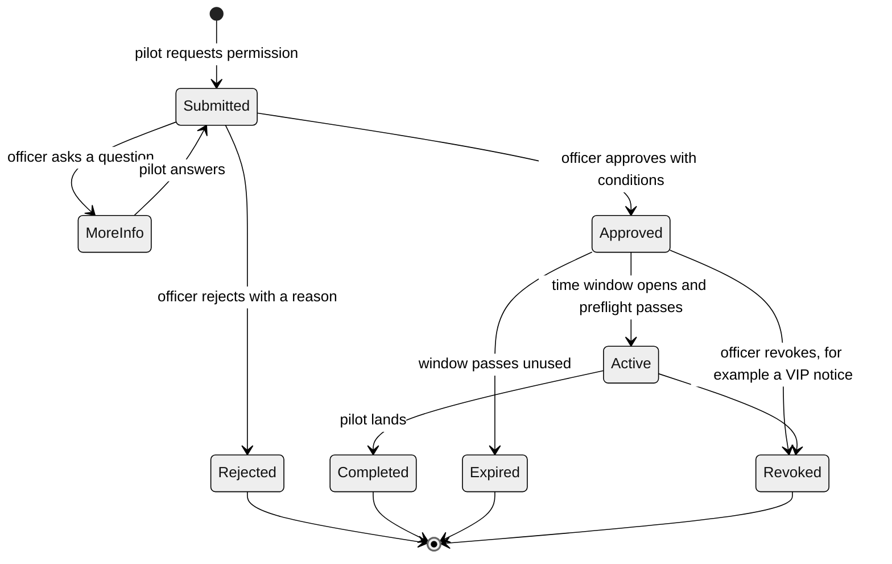

# Permits, verification and the official map

Built in the prototype: routing to the responsible authority, signed permits, preflight, revoke, conflicting permits when a notice is published, document verification with an officer queue, satellite toggle and the red, yellow, green legend. Not built yet: zone editor and zone versions, permit-aware simulation, OTP login, DigiLocker or regulator checks.

How a pilot gets permission, how we know who the pilot and the drone are, and how the zone map stays in the authority's hands. Read with [ARCHITECTURE.md](../ARCHITECTURE.md) and [contracts 9 to 11](CONTRACTS.md).

## Zone classes (green, yellow, red)

| Colour | Meaning | Our verdict | On the map |
|---|---|---|---|
| Red | Flying prohibited. Only the central authority can allow it | prohibited | Solid red zone |
| Yellow | Permission needed before flying | permission_needed | Amber zone |
| Green | No restriction found in our data | can_fly | Not painted. Shown in the check result and the legend |

Green never means safe. It means we found nothing, and the data may be incomplete. The real-world scheme this follows is the Digital Sky style red, yellow and green airspace map. Confirm the exact current rules with the regulator before the demo and cite them in the rules data.

## The permission flow, end to end

1. The pilot picks a yellow-zone spot, time and drone and presses Request permission. This goes to the officials' queue at once.
2. An officer reviews: pilot verified? drone verified? purpose, area, time, conflicts with other permits or notices. They approve with conditions (altitude cap, time window, area), reject with a reason, or ask for more information.
3. Approval creates a permit: permit ID, pilot, drone serial, the exact area, maximum altitude, time window, conditions, who issued it, and a digital signature. The pilot gets the alert and the permit with a QR code.
4. The pilot cannot just fly. Before takeoff they press Preflight. The system re-checks everything now: permit active and in its window, drone serial matches the permit, pilot and drone still verified, no new notice since approval. Only then it returns "cleared" with a short validity time.
5. If something changes (a VIP notice overlaps an approved permit), the officer sees "conflicts with N permits", can revoke, and the pilot is alerted at once. A revoked permit fails the next preflight.
6. In the simulation, a drone in a yellow zone is treated as authorised only if its permit passes preflight. Without one, or with a mismatched serial, it is a breach.

Honest limit: SkyClear cannot physically stop a drone. In the real world, enforcement is the drone firmware refusing to arm without a valid signed permit (the "no permission, no takeoff" idea). We simulate that with the simulator refusing to arm. Say this plainly in the pitch.

## Routing the request to the right official

The pilot can ask to fly anywhere, so the system works out who must decide from the location. Officials only see requests for their own area and type of airspace.

1. Zone owner: every zone has an `authority_id` (airport zone to the airport authority, defence zone to the defence estate officer, park to the forest department, VIP or event notice to the city police, government site to its security office). The request goes to the authority that owns the most restrictive zone the flight touches. The other owners of touched zones are notified and can comment.
2. Jurisdiction: if the zone has no owner, find the authority whose jurisdiction polygon contains the flight area (`$geoIntersects` on `authorities.jurisdiction`).
3. Nearest office: if no polygon matches, use the nearest authority office (`$geoNear` on `authorities.office`) and mark the reason "nearest office".
4. Nothing found, for example a spot outside the places we cover: the pilot is told "no authority registered for this area in our data" and given the official portal. The request is not silently dropped.
5. Escalation: each authority has a response time (`sla_minutes`). An unanswered request is flagged and escalates to the parent authority.
6. If a flight touches zones owned by two authorities, the first version asks only the primary one and notifies the other. A later version can require both to approve.

The pilot sees who will review the request and why, before and after pressing Request. The authority data in the prototype is sample data (the real mapping of offices to areas must be confirmed with the authorities) and is labelled as such.

## Who is this person, and is this their drone

We cannot prove ownership cryptographically. We can prove that an officer checked the documents on a date, and that the drone in the air is the drone on the permit. Three layers:

| Layer | What the pilot provides | Who checks | Result |
|---|---|---|---|
| Pilot identity | Email with a one-time code, remote pilot certificate number, photo of the certificate | An officer, against the regulator's records (a desk check in the prototype) | Pilot badge: verified by officer X on date Y |
| Drone identity | Serial number, registration number (UIN), photo of the drone showing the serial plate, optional purchase invoice | An officer | Drone badge: verified, serial bound to the owner |
| In the air | Telemetry carries the serial | The geofence engine | Serial not on an active permit for this area: breach "unauthorised drone" |

Anti-fraud rules in the data layer: a serial number can belong to only one active owner (unique index), duplicate documents are flagged, only verified pilots with verified drones can request permission, and every verification decision is audited. Documents are stored in MongoDB GridFS, readable only by the owner and officials.

Later, not in the prototype: DigiLocker or the regulator's API for automatic checks, Remote ID broadcast matching.

## The official map: who owns the zones

The authority owns the zone layer. Pilots only read it.

- Sources, in order of trust: (1) official airspace data from the regulator imported as KML or GeoJSON, once we confirm it is available and what licence it carries, (2) zones drawn by officers in the authority console, (3) OpenStreetMap and OurAirports as a labelled fallback ("derived, not official").
- Zone editor in the authority console: draw a polygon on the map (satellite imagery helps), choose red or yellow, altitude band, effective dates, link the rule and a source document. A draft becomes published only when a second officer approves it (maker and checker). Every version is kept in `zone_versions`, every action is in the audit log.
- Temporary zones (VIP movement, event) are the same thing with an end time.
- Pilots see only published versions, each labelled official or derived, with its version and date.
- Both sides use the same MapLibre map and the same `/zones` API. Officers also get extra layers: live drones, pending requests, breaches, draft zones.

## Satellite

| What | How | Status |
|---|---|---|
| Satellite basemap toggle | Sentinel-2 cloudless imagery by EOX (free, CC BY-NC, fine for a non-commercial hackathon) or Esri World Imagery. A layer switch on the map, same zones on top | Easy, assign to the map owner |
| Imagery for drawing zones | Officers draw zone polygons over the satellite layer to match real fences and runways | Part of the zone editor |
| Drone imagery | OpenAerialMap shows open drone imagery. Optional | Idea |
| GPS accuracy | GNSS error is a few metres, so verdicts near a zone edge get a safety buffer and a warning | In PRODUCT.md as B8 |
| Satellite communications and live satellite tracking | Not planned | Out of scope |
