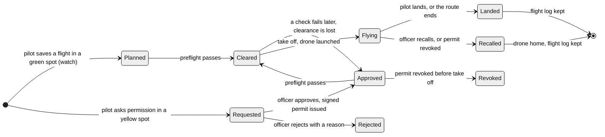
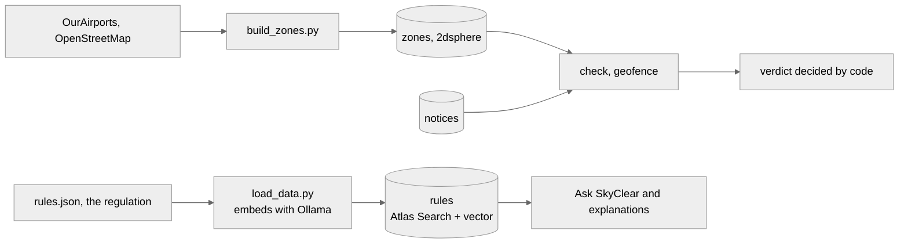

# The flight pipeline

One flight, from "can I fly here?" to landing, and what each step does. Every arrow below is built and covered by `backend/tests/test_pipeline.py` and the browser test `scripts/e2e.py`.

## A flight's life

## What happens at each step

| Step | Who | What the system does | Endpoint |
|---|---|---|---|
| Check | Anyone | Zones, notices and rules for the spot, drone and time. Code decides, the model only explains | `POST /check` |
| Request permission | Verified pilot | Routed to the responsible office (zone owner, then jurisdiction, then nearest). Refused if prohibited or if nothing is needed | `POST /flights` |
| Decide | That office's officer | Approve with altitude cap and conditions (a signed permit is issued) or reject with a reason. The pilot is alerted | `POST /flights/{id}/decision` |
| Preflight | Pilot | Re-checks now: permit active and in its window, drone serial matches, pilot and drone verified, no new restriction. Pass moves the flight to Cleared. Any failure lists the reasons and clearance is lost | `POST /flights/{id}/preflight` |
| Take off | Pilot | Preflight is run again. A simulated drone is launched, bound to the flight and its permit, and flies a loop inside the permitted area | `POST /flights/{id}/launch` |
| In the air | System | Every second: move, geofence against zones and notices, early warning ahead, telemetry into MongoDB. Inside a yellow zone it is clear only while its own permit covers the spot and the time. One entry into restricted airspace is one breach event | `GET /live/drones` |
| Breach | System | The pilot is alerted at once ("Your drone entered restricted airspace"), the count is kept on the flight, the officer sees it in the Live tab | notifications, `GET /live/breaches` |
| Restriction published | Officer | Pilots whose flights overlap are alerted, approved permits it conflicts with are listed | `POST /notices` |
| Recall | Officer | Revoking the permit, or the Recall button, orders the drone home. The pilot is alerted | `POST /permits/{id}/revoke`, `POST /flights/{id}/recall` |
| Land | Pilot or the route ending | The drone lands, the flight log (times, highest point, battery, breaches) is saved, the pilot is told | `POST /flights/{id}/land` |

## Who sees what in the air

| Viewer | Sees |
|---|---|
| The pilot | Only their own drone, with numbers |
| An officer | Every drone: pilots' flights and the background traffic |
| A visitor | Background traffic only (a pilot's position is private) |

Only officials can start or stop the background traffic or run the VIP scenario.

## Where the data lives (MongoDB)

| Step | Collections |
|---|---|
| Check, geofence | `zones`, `notices` (2dsphere geo queries) |
| Rules and Ask | `rules` (Atlas Search plus vector search, merged with `$rankFusion`) |
| Request, permit, preflight | `flights`, `permits`, `authorities` (geo), `verifications`, `files` (GridFS) |
| In the air | `telemetry` (time series), `breaches` |
| Alerts | `notifications` |
| Accounts | `users`, `refresh_tokens`, `otps` |

## The data pipeline behind it

## What is simulated

The drone is a simulation (kinematics with wind and GPS noise), not a real aircraft. It proves the platform's logic, alerting and scale. A real autopilot would write the same telemetry record.
