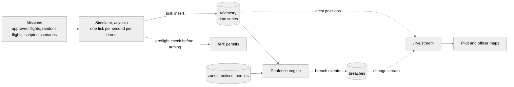

# Simulation plan

How the MVP simulation works, how it is proper without being heavy, and how it grows. Contracts 3 to 5 in [CONTRACTS.md](CONTRACTS.md). Owner: Thanvi.

## What the simulation must show

1. A pilot gets a permit, presses Start simulated flight, and their drone flies the approved route live on the map. The official sees it too.
2. A fleet of 50 to 100 other drones flies around Hyderabad, so the live map and the scale claims are real.
3. When something goes wrong, the system notices in seconds: a drone enters a red zone, enters a yellow zone with no permit, flies with the wrong serial, drifts off its route, or a new VIP notice appears over it.

## Three levels

| Level | What it is | When |
|---|---|---|
| 1, kinematic fleet (MVP) | Each drone is a point that moves along waypoints at a speed, with heading, altitude and battery | First |
| 2, realistic noise | Wind drift, GPS error of a few metres, battery drain with load, occasional signal loss | If level 1 is solid |
| 3, real autopilot | ArduPilot SITL in Docker, MAVLink telemetry through pymavlink, converted to the same telemetry record | Stretch only |

All three write the same telemetry record (contract 5), so the rest of the system never changes.

## How it runs

Each tick, per drone:
1. Move: new position from speed and heading, plus wind and noise at level 2. Drain the battery.
2. Insert the telemetry batch into the time series collection (one bulk insert per tick, not one per drone).
3. Geofence check with MongoDB: `$geoIntersects` of the position against `zones` and active `notices`, and the same for a point 30 seconds ahead along the heading to give an early warning (status `warning` with an ETA).
4. Permit check: if the drone is in a yellow zone, its flight must hold an active permit for this area, drone serial and time. Otherwise it is a breach.
5. Write a breach event once per entry (not once per tick), with the zone, the rule and the position. The change stream pushes it to the maps and to the officer's alert feed.

At 1000 drones, per-drone queries get heavy. The fix is to keep an in-memory spatial index of zones (rebuilt from a change stream on `zones` and `notices`), and use MongoDB queries for the final confirmation and the record. Measure first, optimise second.

## Demo scenarios (scripted, seeded so they replay the same way)

| Scenario | What happens | What it proves |
|---|---|---|
| A, legal flight | Pilot has an approved permit, drone arms, flies the route, lands | Permit and preflight work |
| B, no permit | A drone flies into a yellow zone with no permit | Breach, officer alert |
| C, wrong drone | The serial in telemetry differs from the permit | Unauthorised drone breach |
| D, drift | Wind pushes a legal drone off its route into a restricted area | Early warning, then breach |
| E, VIP notice | An official publishes a notice over running drones | Alerts, revoked permits, breaches in seconds |
| F, low battery | Battery falls under a limit, drone must return | Telemetry rules beyond geofencing |

Controls: `POST /sim/fleet`, `DELETE /sim/fleet`, `GET /sim/status`, `POST /sim/scenarios/{name}` (contract 4). A seed makes every run repeatable, which matters for rehearsal.

## Numbers to record in docs/RESULTS.md

Drones simulated, ticks per second achieved, time from a breach happening to it showing on the map (target under 2 seconds), false breaches, missed breaches (should be 0 on the scripted scenarios), MongoDB insert rate.

## Honest limits

A simulation is not a real drone. It proves the platform's logic, alerting and scale, not flight hardware. Level 3 narrows the gap by running real autopilot software, but it is still software in a loop. Say this in the pitch.

## Build order for Thanvi

1. Level 1 fleet, telemetry into the time series collection, `/live/drones` real.
2. Geofence engine with breach events and the change stream feed.
3. Permit-aware arming, scenarios A, B and E (the core story).
4. Scenarios C, D, F, early warning, level 2 noise.
5. Metrics for RESULTS.md. Level 3 only if everything else is done.
